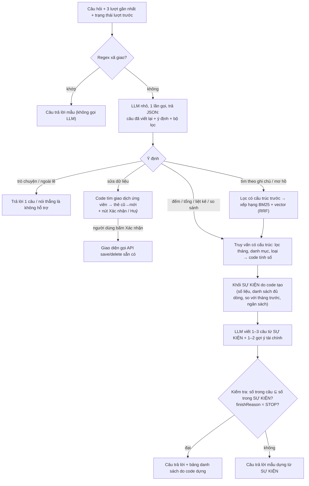

# Chatbot SpendMindAI — phân tích lỗi và thiết kế chatbot RAG riêng

> Trạng thái: **BẢN THIẾT KẾ CHỜ DUYỆT** (25/10/2026). Chưa có dòng mã triển khai nào.
> Phạm vi đã đọc: `api/controllers/ChatbotController.php`, `api/index.php` (định tuyến chat),
> `js/chatbot.js` (phần gửi/nhận), `dev_server.py` (nhánh `chat`), `database.sql` (bảng `transactions`),
> `vercel.json`, và `local_dev_data.json` (để đối chiếu dữ liệu).

## 0. Tóm tắt — đọc phần này là đủ để quyết định

1. **Chatbot hiện tại không có trí nhớ.** Mỗi câu hỏi được gửi đi một mình, không kèm câu trước. Vì vậy
   «Chi tiết cho tôi», «19 giao dịch cụ thể…», «Nó là…», «Làm lại» đều mất chủ ngữ.
2. **Chatbot không nhìn thấy dữ liệu cần để trả lời.** Nó chỉ có: các con số tổng của *tháng hiện tại* và
   **15 giao dịch mới nhất của mọi danh mục**. Hỏi «liệt kê 19 giao dịch Giải trí» thì 19 dòng đó không hề
   nằm trong thứ nó đọc — nên nó liệt kê được 2 cái, rồi bịa thêm bằng giao dịch Ăn uống.
3. **Câu trả lời bị cắt ở 350 token** (khoảng 700–1.000 ký tự tiếng Việt), và mã không kiểm tra lý do dừng.
4. **Giao dịch thật KHÔNG bị sửa.** Trong luồng chat không có đường nào ghi vào CSDL. Câu «Đã cập nhật giao
   dịch…» là LLM *tự bịa ra một hành động* — nguy hiểm vì người dùng tin là đã sửa. (Kết luận từ đọc mã;
   chưa kiểm trên CSDL thật — xem §8.)
5. **Đánh giá thẳng:** mỗi người dùng chỉ có vài trăm giao dịch (dữ liệu mẫu: 129). Phần lớn câu hỏi là
   *đếm / tính tổng / liệt kê theo tháng và danh mục* — những việc **code** làm đúng 100%, LLM làm sai. Vì vậy
   phần cốt lõi của hệ mới là **truy vấn có cấu trúc + lịch sử hội thoại + viết lại câu hỏi**. Tìm kiếm lai
   (BM25 + vector) chỉ cần cho câu hỏi theo *ghi chú* mơ hồ («tôi uống monster mấy lần?», «tiền đi net»). Đề
   xuất làm theo giai đoạn, giai đoạn sau chỉ làm nếu bộ kiểm thử cho thấy cần.
6. **Sửa một giả định ban đầu:** backend hiện là **PHP** (runtime `vercel-php@0.9.0`, `vercel.json:5-8`) +
   **MySQL/TiDB** (`api/config/database.php:4`), không phải Python. Mô hình LLM: Gemini
   `gemini-2.5-flash-lite` (`ChatbotController.php:44-46`).

**Cần bạn chọn** (chi tiết §9): phương án triển khai (khuyến nghị B), mô hình nhúng (khuyến nghị Gemini
Embedding API trước, `multilingual-e5-small` nếu muốn chạy tại chỗ), và có cho phép sửa dữ liệu qua chat
(luôn có nút xác nhận) hay không.

---

## 1. Bản đồ mã chatbot hiện tại

| Thành phần | Vị trí | Hành vi |
|---|---|---|
| Frontend gửi câu hỏi | `js/chatbot.js:692-697` | `POST api?action=chat` với **chỉ** `{ message }` — không có lịch sử |
| Bộ nhớ đệm phía trình duyệt | `js/chatbot.js:612`, `:636-638`, `:677-685` | Cùng chữ trong 45 giây → trả lại câu cũ, bất kể ngữ cảnh |
| Hiển thị markdown | `js/chatbot.js:491-499` | `**…**` thiếu dấu đóng (do bị cắt) hiện ra dấu `**` thô |
| Định tuyến + giới hạn tần suất | `api/index.php:128-133` | 15 câu/phút/người |
| Tổng tháng hiện tại | `ChatbotController.php:60-63`, `:89-101` | Tháng cố định là *tháng này* theo giờ máy chủ |
| Tổng theo danh mục | `ChatbotController.php:103-123` | SQL `COUNT/SUM` — **số đúng** (921.000đ / 19 GD là từ đây) |
| Ngữ cảnh giao dịch | `ChatbotController.php:151-171` | **15 giao dịch mới nhất, mọi danh mục**, mọi tháng |
| Lời nhắc hệ thống | `ChatbotController.php:185-199` | Nhồi toàn bộ số liệu; luật «1–3 câu»; không có luật về hành động |
| Gọi Gemini | `ChatbotController.php:201`, `:231-237` | `contents` chỉ có **một** lượt người dùng |
| Giới hạn đầu ra | `ChatbotController.php:241` | `maxOutputTokens: 350` |
| Đọc kết quả | `ChatbotController.php:273` | Lấy `parts[0].text`, **bỏ qua `finishReason`** |
| Lỗi CSDL | `ChatbotController.php:172-174` | Nuốt lỗi → bot trả lời như thể «chưa có giao dịch» |
| Đường ghi dữ liệu | `TransactionController.php:64` (`save`), `:142` (`delete`) | **Chatbot không gọi tới** — chỉ giao diện chính gọi |
| Chat khi chạy local | `dev_server.py:486-488` | Chỉ gửi câu hỏi, **không** gửi số liệu → không tái hiện được lỗi ở máy |

Dữ liệu thật có **danh mục tự đặt** («Cắt tóc», «Trả nợ», «Ăn uống + rửa xe», «Đám cưới c Phương»…) bên cạnh
10 danh mục chuẩn (`ChatbotController.php:9-20`). Hệ mới phải xử lý cả hai loại.

---

## 2. Bảng lỗi → nguyên nhân gốc → cách sửa

| # | Lỗi trong hội thoại | Nguyên nhân gốc (`tệp:dòng`) | Cách sửa trong hệ mới |
|---|---|---|---|
| 1 | «Chi tiết cho tôi» → đổ toàn bộ tổng quan | Không có lịch sử: `js/chatbot.js:695` chỉ gửi `message`; `ChatbotController.php:231-237` chỉ có 1 lượt. LLM không biết «chi tiết *cái gì*», trong khi lời nhắc (`:185-194`) chứa mọi số liệu → nó kể hết | Gửi 3 lượt gần nhất + **viết lại câu hỏi** thành «Chi tiết các giao dịch mục Giải trí tháng 10/2026» (§3.3) |
| 2 | Trả lời bị cắt («**168.00», «Ngày 2») | `maxOutputTokens: 350` (`:241`); không kiểm `finishReason` (`:273`) nên câu cụt vẫn được gửi như câu đủ. Thêm: khi `flash-lite` lỗi (ví dụ 429 hết hạn mức) và rơi sang `gemini-2.5-flash` (`:204-206`), câu trả lời ngắn vẫn dừng `MAX_TOKENS` — đã thấy ở ca 14, 19 khi chạy `tests/chatbot_eval --target old`; khớp giả thuyết token «suy nghĩ» tính vào hạn mức | Danh sách do **code** dựng (không tốn token LLM); LLM chỉ viết 1–3 câu; nâng hạn mức, tắt suy nghĩ; `finishReason ≠ STOP` → dùng câu trả lời mẫu thay vì gửi câu cụt |
| 3 | «19 giao dịch… là chi vào gì» → «Ăn uống 54, Giải trí 19, Di chuyển 13» (đếm sai, gộp nhầm danh mục) | (a) Không lịch sử → «19 giao dịch» mất gốc «Giải trí». (b) LLM không có 19 dòng đó (`:151-158`), nên nó đọc lại dòng tóm tắt danh mục (`:120`) — thứ duy nhất có chữ «19 giao dịch» | Ý định `liệt_kê` + bộ lọc `{tháng: 2026-10, danh mục: entertainment}` → code chạy truy vấn, trả **đủ 19 dòng** |
| 4 | Chỉ liệt kê 2/19 | Cửa sổ 15 giao dịch mới nhất của **mọi** danh mục (`:151-158`); lúc đó chỉ 2 trong 15 là Giải trí. (Ở dữ liệu mẫu cục bộ: 4/15.) | Như #3: lọc theo danh mục trên **toàn bộ** giao dịch của tháng, không lấy «N cái mới nhất» |
| 5 | «17 còn lại» lấy toàn Ăn uống, lại bị cắt | LLM bị ép đưa 17 dòng mà nó không có → lấy giao dịch khác trong 15 dòng để lấp. Lời nhắc chỉ cấm «bịa số liệu» (`:197`) chứ không dạy «nói *không có dữ liệu*». Luật «1–3 câu» (`:196`) cũng mâu thuẫn với việc liệt kê 17 dòng | Code đảm bảo đủ dòng; luật «thiếu dữ liệu thì nói thẳng»; **kiểm số sau khi sinh**: mọi con số trong câu trả lời phải có trong khối SỰ KIỆN do code tính (§3.6) |
| 6 | «Nó là ăn uống…» → «Đã cập nhật giao dịch 24/10 28.000đ sang Ăn uống» | (a) Không lịch sử → «nó» không rõ là gì, LLM tự chọn giao dịch «ún monster». (b) Không có hợp đồng hành động: lời nhắc (`:195-199`) không nói «bạn không sửa được dữ liệu», nên LLM thoải mái tuyên bố đã làm. **Không có đường ghi nào** trong luồng chat (`:25-217` chỉ `SELECT`) → dữ liệu không đổi, câu trả lời là bịa | Tách ý định `phàn_nàn` và `sửa_dữ_liệu`. LLM **không bao giờ** ghi. Sửa = bot đề xuất thẻ «cũ → mới» + nút **Xác nhận / Huỷ**; chỉ khi bấm, giao diện mới gọi `save` sẵn có (§3.5). Câu trả lời chứa «đã cập nhật/đã xoá» mà không có xác nhận → chặn |
| 7 | «Làm lại» → «Bạn muốn tôi làm lại điều gì?» | Không lịch sử (như #1). Thêm nữa, bộ đệm `js/chatbot.js:636-638` dùng khoá là chữ: gõ «Làm lại» hai lần trong 45 giây sẽ nhận lại đúng câu cũ, kể cả khi ngữ cảnh đã khác hoặc dữ liệu vừa đổi | Lịch sử + **trạng thái hội thoại** (ý định + bộ lọc của lượt trước); «làm lại / tiếp / còn nữa không» → chạy lại ý định trước. Bỏ bộ đệm theo chữ |

Phát hiện thêm (không có trong hội thoại nhưng sẽ gây lỗi tương tự):
- Hỏi tháng khác (ví dụ «tháng 9 tôi chi bao nhiêu») thì không trả lời đúng được: số tổng chỉ có cho tháng
  hiện tại (`:62-63`).
- Lỗi CSDL bị nuốt (`:172-174`) → bot trả lời «chưa ghi nhận giao dịch» thay vì báo lỗi. `AGENTS.md` mục 1 cấm
  kiểu nuốt lỗi này.
- Không tái hiện được lỗi trên máy vì `dev_server.py:486-488` không gửi số liệu. Hệ mới cần chạy được local
  với `local_dev_data.json`.

---

## 3. Kiến trúc đề xuất

### 3.1 Luồng xử lý



Mỗi câu hỏi tài chính tốn **2 lần gọi LLM** (phân tích + viết câu). Câu xã giao: 0 lần. Câu liệt kê có thể
chỉ cần 1 lần (câu dẫn có thể dựng bằng mẫu).

### 3.2 Lớp 0 — regex xã giao

- Chuẩn hoá trước khi so: chữ thường, Unicode NFC, thêm bản **bỏ dấu** (để «cam on» khớp «cảm ơn»).
- Chỉ áp khi **cả câu ngắn** (≤ 6 từ). Không thì «chào, tháng 10 tôi chi bao nhiêu?» bị trả lời «Chào bạn!»
  và mất câu hỏi.
- Mẫu ban đầu (trên bản bỏ dấu):

| Nhóm | Mẫu | Trả lời |
|---|---|---|
| chào | `^(xin )?chao( ban\| bot)?[!. ]*$`, `^(hi\|hello\|alo)\b` | «Chào bạn! Bạn muốn xem chi tiêu nào?» |
| cảm ơn | `\b(cam on\|thank\|thanks\|tks)\b` | «Không có gì! Cần gì cứ hỏi nhé.» |
| tạm biệt | `\b(tam biet\|bye\|hen gap lai)\b` | «Tạm biệt! Hẹn gặp lại.» |
| bot là ai | `\b(ban la ai\|ban lam duoc gi)\b` | Câu giới thiệu khả năng (cố định) |

Kiểm chứng: bộ 20 câu (10 phải khớp, 10 không được khớp, trong đó có «chào, tháng 10 tôi chi bao nhiêu»).

### 3.3 Lớp 1 — viết lại câu hỏi + phân loại ý định (gộp một lần gọi)

Gộp viết lại và phân loại vào **một** lần gọi LLM, bắt trả **JSON theo lược đồ cố định** (Gemini hỗ trợ
`responseSchema`). Lý do: hai việc cùng cần lịch sử; tách ra là thêm một lần gọi, thêm độ trễ.

Đầu vào: hôm nay là ngày nào, danh sách danh mục *của chính người dùng* (chuẩn + tự đặt), 3 lượt gần nhất,
trạng thái lượt trước, câu hỏi mới.

Đầu ra (ví dụ cho «19 giao dịch cụ thể là chi vào gì»):

```json
{
  "rewritten": "Liệt kê 19 giao dịch mục Giải trí tháng 10/2026",
  "intent": "finance_list",
  "filters": { "month": "2026-10", "category": "entertainment", "type": "expense", "keyword": null },
  "clarify": null
}
```

Các ý định:

| Ý định | Ví dụ | Đường xử lý |
|---|---|---|
| `smalltalk` | «bạn khoẻ không» (lọt regex) | Trả lời 1 câu |
| `finance_aggregate` | «tháng 10 giải trí bao nhiêu» | Có cấu trúc: tổng, số giao dịch |
| `finance_list` | «chi tiết giải trí tháng 10» | Có cấu trúc: danh sách đủ dòng |
| `finance_compare` | «tháng này so với tháng trước» | Có cấu trúc: hai kỳ |
| `finance_search` | «tôi uống monster mấy lần» | Lai (BM25 + vector) trên tập đã lọc |
| `advice` | «làm sao tiết kiệm hơn» | SỰ KIỆN tổng quan + gợi ý |
| `complaint` | «nó là ăn uống không phải giải trí» | Xin lỗi, kiểm lại; nếu có vẻ muốn sửa → **hỏi**, không làm |
| `modify_data` | «chuyển giao dịch ún monster sang ăn uống» | Thẻ xác nhận (§3.5) |
| `out_of_scope` | «thời tiết hôm nay» | «Mình chỉ hỗ trợ chi tiêu của bạn.» |
| `unclear` | «cái đó» (không có lịch sử) | Hỏi lại một câu cụ thể |

**Code kiểm lại đầu ra LLM, không tin mù quáng:**
- `category` phải nằm trong danh mục của người dùng; khớp mờ theo bản bỏ dấu («giai tri» → `entertainment`).
  Không khớp → `clarify`.
- `month` phải là tháng hợp lệ, không ở tương lai. «tháng 10» không ghi năm → năm gần nhất đã qua.
- Thiếu bộ lọc mà lượt trước có → **thừa kế** bằng code (không trông vào LLM). Đây là chốt chặn cho «Làm lại»,
  «còn nữa không», «chi tiết hơn».
- `user_id` **luôn** lấy từ phiên đăng nhập, không bao giờ từ đầu ra LLM.

### 3.4 Lớp 2 — truy xuất

**Đường A — có cấu trúc (mặc định cho mọi câu đếm / tổng / liệt kê / so sánh).**
Tải toàn bộ giao dịch của người dùng một lần mỗi yêu cầu (vài trăm dòng, dùng chỉ mục sẵn có
`idx_user_date`, `database.sql:38`), rồi lọc và tính bằng code. LLM **không bao giờ** tự đếm hay tự cộng.

Khối SỰ KIỆN mẫu cho câu #3:

```
KỲ: 10/2026 · DANH MỤC: Giải trí · LOẠI: chi
SỐ GIAO DỊCH: 19 · TỔNG: 921.000đ · TB/GD: 48.474đ
SO VỚI 09/2026: <số do code tính>
NGÂN SÁCH: <hạn mức / đã chi / còn lại, nếu có>
DANH SÁCH: (19 dòng, code dựng thành bảng, gắn thẳng vào câu trả lời)
```

**Đường B — tìm kiếm lai (chỉ cho `finance_search`).**
1. Áp bộ lọc có cấu trúc trước (tháng, danh mục nếu có).
2. Xếp hạng trong tập đã lọc bằng hai cách:
   - **BM25** (`rank_bm25`) trên chữ «danh mục + ghi chú», tách từ theo khoảng trắng, mỗi từ thêm bản bỏ dấu
     («ún» → «un») để khớp kiểu gõ không dấu.
   - **Vector**: cosine giữa vector câu hỏi và vector từng giao dịch.
3. Trộn bằng **RRF** (Reciprocal Rank Fusion — cộng `1/(60 + hạng)` của hai bảng xếp hạng). LangChain có sẵn
   `BM25Retriever` (dùng `rank_bm25`) và `EnsembleRetriever` (trộn kiểu RRF có trọng số), nên không phải tự viết.
4. Có ngưỡng: BM25 = 0 **và** cosine dưới ngưỡng → «Không tìm thấy giao dịch nào khớp "…"». Ngưỡng chỉnh trên
   bộ kiểm thử, không đặt tuỳ ý.
5. Kết quả tìm được lại đi qua Đường A để **code** đếm và tính tổng.

Vì sao Đường B chỉ là phụ: ghi chú trung bình chỉ ~7,5 ký tự («Net», «ún monster»). Vector giúp được ở từ
đồng nghĩa («nước tăng lực» ↔ «monster», «chơi game» ↔ «net»), nhưng với câu hỏi theo tháng/danh mục thì
lọc cấu trúc luôn chính xác hơn.

### 3.5 Ý định «sửa dữ liệu» — bắt buộc xác nhận

- Backend chatbot **không có quyền ghi**. Nó chỉ trả về một *đề xuất*:
  `{ tx_id, trường, giá trị cũ, giá trị mới }`.
- Giao diện hiện thẻ: «Chuyển *24/10 · 28.000đ · ún monster* từ **Giải trí** sang **Ăn uống**?
  [Xác nhận] [Huỷ]».
- Chỉ khi người dùng bấm **Xác nhận**, giao diện mới gọi API `save` / `delete` **đang có**
  (`TransactionController.php:64`, `:142`) — cùng đường như khi người dùng tự sửa trên dashboard. Không thêm
  API ghi mới. Hai API này đã kiểm chủ sở hữu (`:101-109`, `:156`).
- Câu mơ hồ («nó là ăn uống») → ý định `complaint` → bot hỏi lại «bạn muốn chuyển giao dịch nào?», không
  tự đoán.
- Chặn ở bước kiểm tra cuối: câu trả lời chứa «đã cập nhật / đã sửa / đã xoá» mà không có xác nhận → thay bằng
  câu mẫu.

### 3.6 Lớp 3 — sinh câu trả lời + gợi ý

Luật trong lời nhắc (ngắn, rõ):
1. Chỉ dùng số trong khối SỰ KIỆN. Không có trong SỰ KIỆN → nói «Mình không có dữ liệu về …».
2. 1–3 câu. Danh sách đã có bảng do code dựng — **không chép lại bảng**.
3. Bạn không sửa được dữ liệu. Không bao giờ nói đã sửa / đã xoá.
4. Kết thúc bằng 1–2 gợi ý tài chính cụ thể, dựa trên SỰ KIỆN.

Gợi ý tài chính: **code tính tín hiệu**, LLM chỉ diễn đạt. Ví dụ tín hiệu: vượt ngân sách danh mục; danh mục
tăng > 20% so với tháng trước; nhiều giao dịch nhỏ lặp lại (ví dụ 19 lần Giải trí, TB 48.000đ); chi > thu
trong tháng. Không có tín hiệu → một gợi ý chung, ngắn.

Kiểm tra sau khi sinh (khoảng 15 dòng code): rút mọi con số trong câu trả lời, so với tập số trong SỰ KIỆN
(đã chuẩn hoá «921.000đ» = 921000). Có số lạ hoặc `finishReason ≠ STOP` → dùng câu trả lời mẫu dựng từ SỰ KIỆN.
Đây là chốt «đúng số liệu» — không phụ thuộc vào việc LLM có nghe lời hay không.

### 3.7 Lịch sử hội thoại

- Trình duyệt giữ 6 tin nhắn gần nhất (3 lượt) + `state` (ý định và bộ lọc lượt trước), gửi kèm mỗi câu hỏi.
  Máy chủ không cần lưu gì → hợp với serverless.
- Lịch sử chỉ dùng để *hiểu câu hỏi*; số liệu luôn lấy lại từ CSDL theo `user_id` của phiên. Người dùng có sửa
  lịch sử gửi lên thì cũng chỉ thấy dữ liệu của chính họ.
- Bỏ bộ đệm theo chữ ở `js/chatbot.js:612-638`.
- Đánh đổi: tải lại trang là mất lịch sử. Muốn giữ qua thiết bị thì thêm bảng `chat_messages` sau.

---

## 4. Nhúng theo lô và cập nhật khi dữ liệu đổi

**Chữ đem nhúng cho mỗi giao dịch:** `"<tên danh mục>. <ghi chú>"` (ví dụ «Giải trí. ún monster»). Ngày và
số tiền **không** nhúng — chúng được lọc bằng cấu trúc.

**Nơi lưu:** CSDL là nguồn thật, RAM chỉ là bộ đệm.
- Bảng mới `transaction_embeddings(tx_id, user_id, model, content_hash, vector BLOB)`, khoá ngoại tới
  `transactions(id)` với `ON DELETE CASCADE`.
- Mỗi vector 384 chiều × 4 byte ≈ 1,5 KB; 129 giao dịch ≈ 200 KB → nạp vào RAM và tính cosine cho cả tập mất
  dưới một mili-giây.

**Cập nhật — tự lành, không phải móc vào `TransactionController`:**
1. Mỗi yêu cầu chat vốn đã tải hết giao dịch của người dùng (Đường A).
2. Tính `content_hash` của từng dòng từ (danh mục, ghi chú); so với bảng vector.
3. Dòng mới hoặc đã đổi → gom lại, nhúng **một lô** trong một lần gọi; dòng đã xoá → khoá ngoại tự xoá vector.
4. Lần đầu một người dùng chat: nhúng cả lô (vài trăm dòng, một lần).

Như vậy thêm / sửa / xoá giao dịch ở bất kỳ đâu (dashboard, cron, nhập file) đều tự được cập nhật ở lần chat
tiếp theo. Bảng `transactions` không có cột `updated_at` (`database.sql:29-41`), nên so hash là cách chắc nhất.

**Bộ đệm RAM:** dict cấp mô-đun, khoá `(user_id, hash của tập content_hash)`. Trên Vercel Fluid compute, một
phiên bản máy được dùng lại cho nhiều yêu cầu nên bộ đệm thường còn; nhưng không được bảo đảm, nên luôn có
đường nạp lại từ CSDL. Không bao giờ để dữ liệu của người dùng này lọt sang người khác: khoá luôn chứa `user_id`.

---

## 5. Chọn mô hình nhúng

Không có bảng đo nào trên đúng loại dữ liệu này (ghi chú chi tiêu ngắn, có teencode). Số tham khảo tốt nhất
tìm được là **VN-MTEB** (41 bộ dữ liệu tiếng Việt), cột *Retrieval* (truy xuất):

| Ứng viên | Tham số | Truy xuất VN-MTEB | Chiều vector | Giấy phép | Chạy CPU | Ghi chú |
|---|---|---|---|---|---|---|
| **`intfloat/multilingual-e5-small`** | 118M | **34,12** | 384 | MIT | Tốt | Nhỏ nhất trong nhóm khá. Bắt buộc tiền tố `query: ` / `passage: `. ~470 MB ở fp32 (ước tính = tham số × 4 byte) |
| `Alibaba-NLP/gte-multilingual-base` | 305M | **38,38** | 768 (thu nhỏ được 128–768) | Apache-2.0 | Được, chậm hơn ~2,5× (ước tính theo số tham số) | Chất lượng cao hơn; cần `trust_remote_code` |
| `bkai-foundation-models/vietnamese-bi-encoder` | 135M | 25,37 | 768 | Apache-2.0 | Tốt | Chuyên tiếng Việt nhưng điểm truy xuất chung thấp hơn; **bắt buộc tách từ trước** (pyvi/underthesea) → thêm thư viện; tối đa 256 token |
| *(loại)* `BAAI/bge-m3`, `AITeamVN/Vietnamese_Embedding` | 568M | 39,84 / 34,18 | 1024 | — | Nặng | Quá nặng cho serverless; AITeamVN ngang e5-small mà to gấp ~5 lần |
| *(không chạy tại chỗ)* **Gemini Embedding API** (`gemini-embedding-001`) | — | không có trong VN-MTEB | 128–3072 (khuyên 768) | Dịch vụ trả phí theo lượng | Không cần | Không thêm gì vào gói; đã có `GEMINI_API_KEY`; có `task_type` RETRIEVAL_QUERY / RETRIEVAL_DOCUMENT; có Batch API |

**Khuyến nghị:**
- **Giai đoạn đầu: Gemini Embedding API.** Lý do: gói triển khai không phình thêm vài trăm MB, khởi động nguội
  không phải nạp mô hình, và ghi chú giao dịch *vốn đã* được gửi sang Gemini trong luồng chat hiện tại — không
  thêm rủi ro riêng tư mới. Cái giá: mỗi câu `finance_search` thêm một lần gọi mạng; phụ thuộc Google.
  *(Giá và hạn mức miễn phí của API nhúng chưa kiểm trong phiên này.)*
- **Nếu muốn mô hình chạy tại chỗ** (không phụ thuộc API, đúng yêu cầu «nhúng vào RAM»):
  `multilingual-e5-small`, chạy bằng ONNX Runtime thay vì PyTorch để gói nhỏ. Chọn nó thay vì bkai vì điểm
  truy xuất cao hơn rõ (34,12 so với 25,37), không cần tách từ, giấy phép MIT.
- Nâng lên `gte-multilingual-base` **chỉ khi** bộ kiểm thử §7 cho thấy e5-small bỏ sót.
- Quyết định cuối dựa trên số đo của chính bạn: Bước 6 trong kế hoạch đo *recall@5* của từng ứng viên trên
  10–15 câu hỏi theo ghi chú.

---

## 6. Triển khai: Vercel có chạy được không?

Sự thật về Vercel Functions (Fluid compute, trang giới hạn cập nhật 24/08/2026):
- RAM: Hobby **2 GB / 1 vCPU**; Pro tối đa 4 GB / 2 vCPU.
- Thời gian chạy tối đa: Hobby 300 giây; Pro 800 giây.
- Gói Python: **500 MB** chưa nén (bản thử nghiệm «Large functions»: tới 5 GB).
- Một phiên bản máy phục vụ nhiều yêu cầu đồng thời và được dùng lại → biến toàn cục *có thể* sống qua nhiều
  lần gọi, nhưng không có cam kết sống bao lâu.
- Vercel chạy được FastAPI như một Function Python, cùng dự án với PHP hiện tại.

Vậy «nhúng một lần vào RAM» trên Vercel: **được, nếu coi RAM là bộ đệm** và luôn có đường nạp lại từ CSDL
(§4). Không được nếu coi RAM là nơi lưu duy nhất.

| | A. Giữ PHP, sửa ngay trong `ChatbotController` | **B. FastAPI trên Vercel, cùng dự án (khuyến nghị)** | C. Dịch vụ riêng (Render / Fly / VPS) |
|---|---|---|---|
| Sửa được 7 lỗi | Có | Có | Có |
| Đúng stack FastAPI + LangChain + rank_bm25 | Không (BM25 tự viết ~40 dòng PHP) | Có | Có |
| Thêm hạ tầng | Không | Một Function Python | Một dịch vụ + giám sát riêng |
| Khởi động nguội | Như hiện tại | Thêm thời gian nạp Python + LangChain (+ mô hình nếu chạy tại chỗ) — **cần đo ở Bước 2** | Render miễn phí: ngủ sau 15 phút không có ai gọi, dậy mất **khoảng 1 phút** → không chấp nhận được cho chat; phải trả gói Starter |
| RAM giữ mô hình | — | Bộ đệm, không bảo đảm | VPS / gói trả phí: giữ thật |
| Xác thực | Sẵn có | PHP vẫn là cửa: kiểm phiên + giới hạn tần suất, rồi gọi Python kèm `user_id` và chữ ký bí mật nội bộ | Như B, cộng mở cổng ra Internet |
| Chi phí vận hành | Thấp nhất | Thấp | Cao nhất |

**Khuyến nghị B**, cụ thể:
- Thêm `api/rag/index.py` (FastAPI) với runtime Python trong `vercel.json`; thêm luật chuyển hướng
  `/api/rag/...` **đặt trước** luật `/api/:path*` (hiện luật này bắt mọi đường `/api/...` về `index.php`).
- Frontend vẫn gọi `api?action=chat`. PHP kiểm phiên (phiên lưu trong CSDL, `api/config/database.php:242`) và giới hạn
  tần suất (`index.php:130`), rồi chuyển tiếp sang Python với `user_id` + chữ ký HMAC từ biến môi trường mới
  (ví dụ `RAG_INTERNAL_SECRET` — bạn tự thêm trên Vercel). Lý do: không phải viết lại đăng nhập bằng Python,
  không phải đọc định dạng phiên của PHP.
- Python đọc CSDL bằng cùng `DATABASE_URL`.
- Nhúng: bắt đầu bằng Gemini API → gói nhỏ, khởi động nhanh. Chuyển sang e5-small ONNX chỉ khi cần.
- LangChain: chỉ dùng phần cần (`langchain-google-genai`, `BM25Retriever`, `EnsembleRetriever`). Không dùng
  agent hay tool-calling của LangChain cho việc ghi dữ liệu — ghi luôn qua nút xác nhận.
- `dev_server.py` cần nhánh chat gọi được pipeline mới với `local_dev_data.json`, để kiểm thử trên máy.

Chọn A nếu bạn muốn sửa lỗi nhanh nhất và không cần đúng stack Python. Chọn C chỉ khi chấp nhận trả phí dịch
vụ luôn chạy.

---

## 7. Kế hoạch theo bước (mỗi bước có cách kiểm chứng)

| Bước | Việc | Kiểm chứng |
|---|---|---|
| 0 | Bộ kiểm thử hồi quy từ §8: script chạy các ca trên `local_dev_data.json`; **đáp án số do code tính từ dữ liệu**, không ghi cứng. → `tests/chatbot_eval/` (`run_eval.py` ghi cả hợp đồng API hệ mới ở đầu tệp) | Script chạy được, in đạt/trượt từng ca; với chatbot cũ phải **trượt** các ca 1–8 (tái hiện lỗi) |
| 1 | *(Tuỳ chọn, chữa cháy trong PHP trong lúc chờ hệ mới)* gửi 3 lượt lịch sử; bỏ bộ đệm theo chữ; nâng `maxOutputTokens` + kiểm `finishReason`; thêm luật «không tuyên bố đã sửa» | Ca 1, 2, 6, 7 đạt; câu trả lời không còn bị cắt |
| 2 | Dựng FastAPI trên Vercel + PHP chuyển tiếp có chữ ký | `/api/rag/healthz` trả 200; gọi thiếu/sai chữ ký → 401; đo kích thước gói và thời gian khởi động nguội (p50 của 5 lần) |
| 3 | Lớp regex + lớp viết lại/phân loại (JSON) + code kiểm lại bộ lọc | 20 câu regex đúng 100%; ≥ 95% câu trong §8 đúng ý định; ca «Làm lại» thừa kế đúng bộ lọc |
| 4 | Đường A có cấu trúc + khối SỰ KIỆN + bảng do code dựng | Mọi số trong ca 1, 3, 4, 5 **khớp 100%** với SQL `COUNT/SUM` độc lập; danh sách đủ 19/19 dòng |
| 5 | Ý định sửa + thẻ xác nhận ở `js/chatbot.js` | Ca 6: CSDL **không đổi** sau câu phàn nàn; chỉ đổi sau khi bấm Xác nhận; bấm Huỷ không đổi gì |
| 6 | Bảng vector + cập nhật theo hash + tìm kiếm lai | recall@5 trên 10–15 câu hỏi theo ghi chú, so từng ứng viên ở §5; thêm/sửa/xoá một giao dịch rồi hỏi lại → kết quả đổi đúng |
| 7 | Sinh câu + gợi ý + kiểm số sau khi sinh | 100% câu trả lời có `finishReason = STOP`; 0 con số lạ trên toàn bộ ca; mỗi câu tài chính có ≥ 1 gợi ý |
| 8 | Triển khai (push main → Vercel) và chạy bộ kiểm thử trên tài khoản thử | Bộ kiểm thử đạt trên bản đã triển khai; độ trễ p95 ghi lại vào `AGENTS.md` |

---

## 8. Bộ câu hỏi kiểm thử (lấy từ đoạn hội thoại lỗi)

Mỗi ca chạy *nối tiếp* trong một hội thoại, đúng thứ tự như người dùng đã hỏi. «N», «T» là số do code tính từ
dữ liệu lúc chạy (ở bản thật lúc đó: N = 19, T = 921.000đ).

| # | Người dùng hỏi | Câu viết lại mong đợi | Ý định | Đạt khi |
|---|---|---|---|---|
| 1 | Mục giải trí tôi đã chi gì | Các khoản chi mục Giải trí tháng 10/2026 | `finance_list` | Nêu T, N; có danh sách N dòng; không nói gì về danh mục khác |
| 2 | Chi tiết cho tôi | Chi tiết các giao dịch mục Giải trí tháng 10/2026 | `finance_list` | Đủ N dòng (ngày, số tiền, ghi chú); **không** có số dư ròng, tổng thu, danh mục khác; không bị cắt |
| 3 | Trong tháng 10 mục giải trí tôi đã chi cái gì | (giữ nguyên, đã đủ thực thể) | `finance_list` | Như ca 2 |
| 4 | 19 giao dịch cụ thể là chi vào gì | Liệt kê 19 giao dịch mục Giải trí tháng 10/2026 | `finance_list` | Đủ N dòng, toàn bộ là Giải trí; không có dòng «Ăn uống: 54 giao dịch» |
| 5 | Chi tiêu chi tiết giải trí trong tháng 10 | (giữ nguyên) | `finance_list` | Đủ N dòng, không phải 2 |
| 6 | Bạn liệt kê chi tôi là 19 giao dịch đây mới có 2 Thiếu 17 giao dịch nữa | Liệt kê đầy đủ 19 giao dịch mục Giải trí tháng 10/2026 | `finance_list` (hoặc `complaint` → liệt kê lại) | Đủ N dòng Giải trí; 0 dòng danh mục khác |
| 7 | Nó là ăn uống không phải giải trí | — | `complaint` | **CSDL không đổi**; bot không nói «đã cập nhật»; bot hỏi lại giao dịch nào hoặc đề xuất thẻ xác nhận |
| 8 | Làm lại | Liệt kê 19 giao dịch mục Giải trí tháng 10/2026 | `finance_list` (thừa kế) | Chạy lại đúng ý định + bộ lọc lượt trước |

Ca bổ sung (để phủ các đường còn lại):

| # | Câu hỏi | Ý định | Đạt khi |
|---|---|---|---|
| 9 | xin chào / cảm ơn / tạm biệt | regex | Trả lời mẫu, **0** lần gọi LLM |
| 10 | chào, tháng 10 tôi chi bao nhiêu | `finance_aggregate` | Regex **không** nuốt câu; số khớp SQL |
| 11 | Tháng 9 tôi chi bao nhiêu cho di chuyển | `finance_aggregate` | Đúng tháng 9 (chatbot cũ không làm được) |
| 12 | Tôi uống monster mấy lần rồi | `finance_search` | Tìm thấy «ún monster»; số lần do code đếm |
| 13 | Tiền đi net tháng này | `finance_search` | Tìm thấy «Net» 50.000đ ngày 22/10 |
| 14 | Chuyển giao dịch ún monster sang ăn uống | `modify_data` | Hiện thẻ cũ→mới; CSDL chỉ đổi sau Xác nhận |
| 15 | Xoá giao dịch Net | `modify_data` | Thẻ xác nhận; Huỷ thì không đổi |
| 16 | Thời tiết Hà Nội hôm nay | `out_of_scope` | Một câu nói thẳng là không hỗ trợ |
| 17 | Tôi chi bao nhiêu cho du thuyền | `finance_search` | «Không tìm thấy giao dịch nào khớp» — không bịa |
| 18 | Tháng này so với tháng trước | `finance_compare` | Hai số khớp SQL; chênh lệch do code tính |
| 19 | Làm sao tiết kiệm hơn | `advice` | Gợi ý dựa trên tín hiệu thật (ví dụ danh mục tăng mạnh) |

**Việc nên làm ngay, không phụ thuộc thiết kế:** mở dashboard kiểm giao dịch 24/10/2026 · 28.000đ · «ún monster».
Theo mã, nó vẫn ở mục Giải trí (chatbot không sửa được gì). Nếu bạn thật sự muốn nó là Ăn uống, hãy sửa tay.

---

## 9. Cần bạn quyết định trước khi xây

1. **Phương án triển khai:** A (sửa trong PHP), **B (FastAPI trên Vercel — khuyến nghị)**, hay C (dịch vụ riêng).
2. **Mô hình nhúng:** **Gemini Embedding API trước (khuyến nghị)**, hay chạy tại chỗ `multilingual-e5-small` ngay
   từ đầu.
3. **Sửa dữ liệu qua chat:** cho phép kèm nút xác nhận (như §3.5), hay chỉ hướng dẫn người dùng tự sửa.
4. **Lịch sử hội thoại:** giữ ở trình duyệt (mất khi tải lại trang — đơn giản), hay lưu ở máy chủ.
5. **Bước 1 chữa cháy trong PHP:** làm ngay (vài giờ, hết lỗi cắt cụt và mất ngữ cảnh) trong lúc xây hệ mới,
   hay bỏ qua.

---

## Nguồn

- VN-MTEB: Vietnamese Massive Text Embedding Benchmark — bảng 3 (điểm truy xuất từng mô hình):
  https://arxiv.org/html/2507.21500v1
- `intfloat/multilingual-e5-small` (MIT, 12 lớp, 384 chiều, 512 token, tiền tố query/passage):
  https://huggingface.co/intfloat/multilingual-e5-small
- `Alibaba-NLP/gte-multilingual-base` (Apache-2.0, 305M, 768 chiều, 8192 token):
  https://huggingface.co/Alibaba-NLP/gte-multilingual-base
- `bkai-foundation-models/vietnamese-bi-encoder` (Apache-2.0, PhoBERT-base-v2, cần tách từ):
  https://huggingface.co/bkai-foundation-models/vietnamese-bi-encoder
- `google/embeddinggemma-300m` (đã xem, không chọn: giấy phép Gemma, không có trong VN-MTEB):
  https://huggingface.co/google/embeddinggemma-300m
- Gemini API — Embeddings (`gemini-embedding-001`, `gemini-embedding-2`, MRL, task_type, Batch API):
  https://ai.google.dev/gemini-api/docs/embeddings
- Vercel Functions Limits (RAM, thời gian, kích thước gói): https://vercel.com/docs/functions/limitations
- Vercel Fluid compute (dùng lại phiên bản máy giữa các lần gọi): https://vercel.com/docs/fluid-compute
- Vercel — Python bundle 500 MB / Large functions 5 GB:
  https://vercel.com/changelog/vercel-functions-can-now-be-up-to-5-gb-in-package-size
- Render — dịch vụ miễn phí ngủ sau 15 phút, dậy khoảng 1 phút: https://render.com/docs/free
